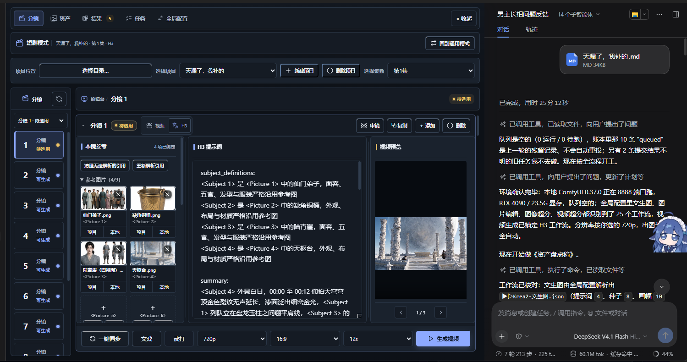
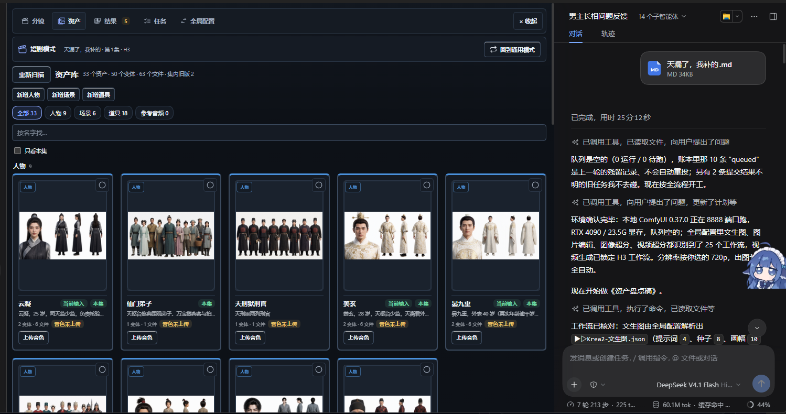
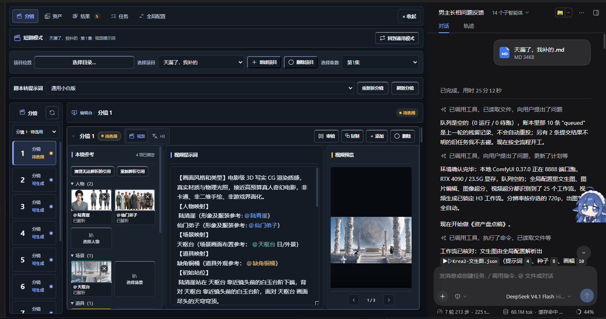
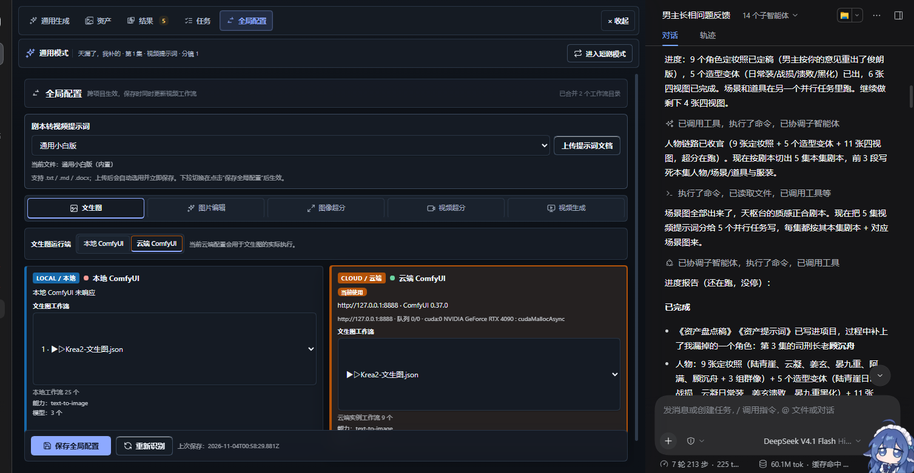

# 短剧制作导演

> 想用 ComfyUI 免费做短剧，又不想学节点连线？这个项目把剧本、资产、分镜、视频提示词和 H3 工作流放进了 DeepSeek Harness 的创作台。

短剧制作导演是一个 **DeepSeek Harness / DSH Desktop 插件**，不是 DeepSeek 网页版功能，也不是通用 Agent 插件。它通过 Agent 调用本机或云端 ComfyUI，并在插件内提供资产库、分镜管理、视频提示词、MiniMax H3 转换、工作流配置和生成任务面板。

它适合不想从零搭 ComfyUI 工作流的单人创作者，也适合需要交接项目、复用资产和逐步返工的小团队。默认目标是让用户判断内容，插件负责资产绑定、工作流选择、任务提交、结果回收和归档。

当前版本：`1.1.0`

<p align="center">
  
</p>

## 一眼看懂


一个典型流程：

1. 导入或粘贴剧本，让 Agent 盘点本集需要的资产。
2. 在资产库中确认人物、服装、场景和道具版本。
3. 生成或粘贴分镜，把 `@人物`、`@场景`、`@道具` 绑定到具体资产。
4. 在分镜面板检查参考图、视频提示词和工作流。
5. 提交到本地或云端 ComfyUI，等待任务完成。
6. 在结果区播放、比较、重做或选用，继续下一集。

## 界面截图

| 资产管理 | 分镜与 H3 绑定 |
| --- | --- |
|  |  |

<p align="center">
  
</p>

## 它能做什么

### 短剧制作流程

- 从剧本整理人物、场景和道具资产，避免把盘点稿误识别为资产。
- 通过 ComfyUI 生成定妆照和资产图，不依赖按张购买的生图 API。
- 场景日夜、人物服装等变体必须从原资产走图像编辑，不允许用文生图重新造资产。
- 自动生成分集视频提示词，并把 `@人物`、`@场景`、`@道具` 绑定到具体资产版本。
- 将确认后的视频提示词转换为 MiniMax H3 中文格式。
- 在右侧分镜管理面板查看镜头、参考素材、视频提示词和生成结果，不必在多个文件之间来回切换。
- 支持拆分、重新拆分和复制分镜；提示词正文仍然是内容来源，界面只展示解析结果。

### 工作流与执行

- 支持本地 ComfyUI、云端 ComfyUI 和双端切换。
- 全局配置中可以按任务分别选择工作流，本地和云端环境可以保存不同选择。
- 自动扫描工作流目录，识别任务能力、模型引用、输出节点状态和匹配情况。
- 工作流改动后会重新检查；模型缺失、必需输入缺失或输出节点被旁路时，在提交前提示。
- 支持工作流记忆，把与剧情无关的兼容性经验和踩坑记录保存下来，供后续会话复用。
- 自动发现 ComfyUI、Python、模型和工作流位置，不写死安装盘符。

### 任务与结果

- 记录生成任务、候选视频和成片归档位置，任务面板刷新后重新从实例核对结果。
- “ComfyUI 运行完成”“文件已保存”“用户已选用”是三个独立事实，不混成一个成功状态。
- 生成失败时尽量保留原输入与候选，便于只重做有问题的镜头。
- 项目、资产和生成结果保存在用户自己的目录，不混入插件仓库。

## 工作流可以切换，但不建议从空白图重搭

工作流选择入口在 **全局配置 → 对应任务 → 本地 / 云端 → 工作流**。本地和云端是两套独立配置，保存后会按当前执行环境解析对应工作流。

**最推荐的做法：复制随插件或整合包提供的已验证工作流，在副本上修改。**

原因很直接：插件不只需要一个能出图的 ComfyUI 图，还需要知道提示词写进哪个节点、参考图对应哪个输入、哪些参数可以安全覆盖、哪个输出才是最终结果。从空白图开始搭当然可以，但需要额外完成这些绑定和验证；基于现有工作流改，通常兼容性更强，也更容易定位问题。

推荐顺序：

1. 先在 ComfyUI 中打开一份插件提供的工作流。
2. 另存为新的文件名，例如 `H3-我的工作流-v1.json`，不要直接覆盖原始文件。
3. 保留输入、参考素材、提示词、输出和关键模型节点，只替换或插入需要改动的节点。
4. 在 **全局配置** 中选中新工作流，保存并检查识别到的工作流能力、模型和输出节点。
5. 先跑一条短镜头，确认参考图、提示词、时长、输出文件和音频都正确，再接入整集。

当前兼容边界：

- **随插件提供的已验证工作流**：兼容性最高，适合直接使用。
- **基于已验证工作流的小改版**：例如替换同类型模型、LoRA、采样参数或增加一个后处理节点。只要保留必要输入和输出，通常最容易迁移。
- **结构相近但未知的工作流**：插件会尝试识别能力；当前会话有可用模型时，也可能生成语义适配表，但这不是“任意工作流一键兼容”的承诺。
- **结构差异过大的工作流**：可能需要显式完成输入、输出和任务角色映射，否则应在验证阶段阻断，而不是带病提交 GPU 任务。

更完整的改造步骤、验证清单和常见故障见 [工作流兼容与改造指南](docs/WORKFLOW-GUIDE.md)。

## 两种模式，一个底座

| 模式 | 适合做什么 | 边界 |
| --- | --- | --- |
| 通用模式 | 单张生图、图片编辑、视频生成、超分和临时实验 | 不要求创建短剧项目 |
| 短剧模式 | 剧本、资产、分镜、视频提示词、H3、任务结果和成片归档 | 需要明确的短剧项目目录与模式状态 |

模式切换是显式操作，不会因为打开某个面板或扫描工作流就自动进入短剧流程。只浏览分镜、查看资产或做环境预检，不会启动 GPU 生成任务。

## 还有这些细节

- 资产可按类型筛选，并查看本集是否使用；同角色不同服装、不同状态不会被当成同一个文件。
- 四视图、换装等衍生资产从原始资产发起，保留来源，不把重绘结果伪装成原图。
- 分镜支持新增、复制、拆分和重新拆分。`【大分镜N】` 只用于展示，正文里的时长和内容仍是解析来源。
- 视频提示词可以绑定具体资产版本；生成计划会显示实际使用的参考图顺序、任务方案和执行环境。
- H3 转换和校对会保留提示词来源；来源发生变化时会提示同步，而不是静默覆盖。
- 任务面板显示排队、运行、完成、下载失败和待核对等状态，刷新或重启后可重新检查结果。
- 本地和云端可以保存不同工作流与参数，不会因为切换一端而悄悄覆盖另一端。
- 多个工作流目录会被合并扫描；云端实例离线时仍可显示上次同步的缓存。
- 工作流记忆可保存与剧情无关的兼容性经验，后续会话可以继续复用。
- 环境发现会检查用户配置、环境变量、上次路径、同级目录和磁盘目录，不依赖作者机器的盘符。

## 适合谁

- 想用本地 ComfyUI 做短剧，但不想每天手连节点的人。
- 需要把剧本、资产、分镜、提示词和生成结果放在同一套项目结构里的人。
- 有自己工作流，希望基于现成流程做少量改动并保留可追溯性的人。
- 需要交接项目、复用资产、重做个别镜头的小团队。

不适合把它当成“任何 ComfyUI 工作流零配置直接跑”的万能执行器，也不适合把未验证的输入直接投入整集批量生成。

## 运行要求

- DeepSeek Harness / DSH Desktop，需兼容插件声明的 `0.2.0-rc.2` peer dependencies。
- 图片和视频生成需要本机或云端 ComfyUI。仅使用剧本、分镜、提示词和 H3 转换时，可以先不连接 ComfyUI。
- Windows 是目前完整支持本地实例启停和桌面安装的目标平台。其他系统仍可使用不依赖 Windows 启动器的功能。

## 安装

### 本地 ZIP

1. 在 GitHub Releases 下载插件包并解压。
2. 打开 DSH 的“插件管理”，选择安装本地插件。
3. 目标选择解压后的 `dsh-plugin-short-drama-director` 文件夹。
4. 启用组合包并按 DSH 提示完整重启应用。
5. 新建会话时选择“短剧制作导演”预设，或输入 `/drama` 切换短剧模式。

详细步骤见 [安装说明.md](安装说明.md)。

## 快速开始

1. 打开 DSH，新建会话并选择“短剧制作导演”预设。
2. 在“全局配置”里先测试本地或云端 ComfyUI 连接。
3. 图片任务优先选择随整合包提供的已验证工作流；需要自定义时先复制一份再改。
4. 新建短剧项目，导入剧本或直接粘贴本集正文。
5. 进入短剧模式，让 Agent 盘点资产并拆出分镜。
6. 在镜头的参考素材区检查 `@人物`、`@场景`、`@道具` 是否绑定到正确版本。
7. 检查视频工作流、参考图顺序、时长和执行环境。
8. 先提交一条短镜头，确认画面、声音、输出文件和归档位置。
9. 结果正常后再做整集；生成失败的镜头保留输入，只重做问题部分。

只使用剧本整理、分镜和 H3 提示词转换时，可以先不连接 ComfyUI；真正生成图片或视频时才需要可用的实例。

## ComfyUI 整合包

整合包不放进 Git 仓库。公开下载：

- [ComfyUI-Deploy-20261022](https://pan.quark.cn/s/9bdfb25e63dc?pwd=fv42)
- 提取码：`fv42`

部署技能会读取包内清单，扫描实际 ComfyUI、Python、模型和工作流目录。安装位置由用户自己决定，项目不附带作者机器路径。

安装后应向 Agent 说明：

```text
使用 comfyui-deploy 技能，检查我会话的文件沙箱权限。
先扫描我已经下载的 ComfyUI-Deploy-20261022 整合包和现有 ComfyUI，
再让我选择安装目录。不要写死路径，不要启动 GPU 生成任务。
```

## 项目结构

```text
.
├─ index.js                 Host 入口与工具注册
├─ client.js                左侧创作台
├─ cordis.patch.yml         Host 行与短剧导演预设
├─ lib/                     资产、分镜、H3、媒体、任务和工作流实现
├─ skills/                  随插件加载的 12 个技能
├─ vendor/adm-zip/          读取用户 .docx 的本地运行依赖
└─ scripts/package-plugin.mjs
```

## 已知限制

- 当前 `1.1.0` 仍处于持续迭代阶段，Windows 是本地实例启停和桌面安装的完整支持目标。
- “自动识别工作流”是辅助能力，不是对所有第三方 ComfyUI 图的兼容承诺。
- 工作流节点、输入名称、模型、自定义节点版本变化后，需要重新检查和实跑验证。
- 本地运行免的是按张/按次 API 费用，不表示 GPU、电力和维护成本为零。
- 不同模型、显卡、节点版本和输入素材仍可能导致结果差异；插件保证输入可追溯，不保证字节级重现。
- 生成完成、下载成功和人工选用是不同状态；未核对的任务不会因为等待超时自动重投。

## 数据与隐私

- 用户项目、资产、生成结果和本机路径不会提交到本仓库。
- 插件运行数据保存在用户自己的 `%DSH_HOME%` 或项目目录中。
- 仓库不包含 API Key、SSH 密码、云服务凭据或 ComfyUI 模型权重。
- 反馈问题时请先移除日志里的用户名、项目路径、实例地址和凭据。

## 许可与二次售卖

本项目采用 [Short Drama Director Source-Available License 1.0](LICENSE)。这是一份**源码公开许可，不是 OSI 定义的开源许可证**。

允许：

- 个人或团队使用、复制、修改源码。
- 使用本插件制作并商业化自己的短剧、广告或其他视频内容。
- 免费分享未修改或修改后的版本，但必须保留许可和署名。

禁止：

- 收费出售、出租、付费打包或以其他方式二次售卖插件本体。
- 把插件或修改版放进付费插件市场、付费课程资源包或按次收费的软件分发中。
- 移除版权和许可声明后重新发布。

插件生成的视频内容归内容制作者所有；ComfyUI、模型、工作流和其他第三方内容的授权仍按各自许可处理。详见 [THIRD_PARTY_NOTICES.md](THIRD_PARTY_NOTICES.md)。

## 反馈

请通过 GitHub Issues 报告可复现的问题。提交前先移除个人信息、凭据、项目资产和本机绝对路径。
