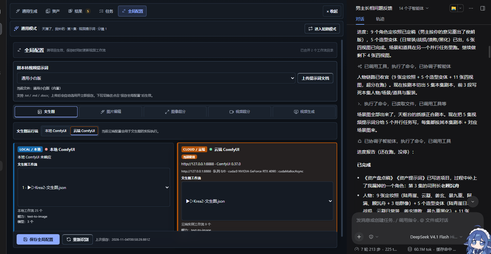

# 工作流兼容与改造指南

短剧制作导演支持切换工作流，但“可选择”不等于“任意工作流都天然兼容”。

最稳妥的做法是：**复制一份随插件或整合包提供的已验证工作流，在副本上修改。** 这样已经具备正确的输入、提示词、参考素材、输出和任务角色，只需要处理你真正想改的部分。



## 1. 工作流在哪里切换

入口：**全局配置 → 对应任务 → 本地 / 云端 → 工作流**。

- 图片任务和视频任务分别选择。
- 本地 ComfyUI 与云端 ComfyUI 分别保存。
- 点击“保存全局配置”后写入设置。
- 视频任务保存时，还会把当前采样参数写回选中的工作流文件，并保留备份。

只扫描目录、查看工作流或测试连接不会启动 GPU 生成。只有明确的生成操作才会提交任务。

## 2. 推荐兼容等级

| 等级 | 工作流来源 | 建议 |
| --- | --- | --- |
| A | 插件或整合包附带的已验证工作流 | 直接使用；升级后如节点或模型变化，重新检查 |
| B | 从 A 复制后替换模型、LoRA、采样器或后处理节点 | 最推荐的自定义方式；保留原输入和输出 |
| C | 结构相近，但插件第一次见到的 ComfyUI 工作流 | 先检查能力、输入和输出；允许时让模型生成语义适配，但仍需实跑验证 |
| D | 完全不同的结构，或缺少提示词/素材/输出角色 | 先手动整理工作流；不要在未验证时接入批量生产 |

插件会尝试读取工作流能力、模型引用、输出节点状态和任务匹配情况。无法确认的部分应停在验证阶段，不能靠猜测提交。

## 3. 推荐的改造步骤

### 第一步：复制原工作流

在 ComfyUI 中打开插件提供的对应工作流，另存为新文件：

```text
原始：H3-已验证工作流.json
副本：H3-我的工作流-v1.json
```

不要直接覆盖原始文件。保留一份能工作的版本，才有可靠的回退路径。

### 第二步：先明确要改什么

常见改动：

- 换同类型 Checkpoint、UNet、VAE 或 LoRA。
- 调整分辨率、帧数、步数、采样器或上下文参数。
- 增加参考图、音频参考、首尾帧或后处理节点。
- 增加超分、插帧、音频处理或文件命名节点。
- 把文戏和武打拆成两个工作流，再由全局配置切换。

不要同时修改所有部分。一次只改一类内容，更容易定位失败原因。

### 第三步：保留必要的角色节点

至少要让插件仍然能确认：

- 正向提示词写到哪里。
- 负向提示词在哪里，是否必需。
- 参考图片、音频或视频对应哪些输入。
- 最终输出节点是哪一个。
- 哪些模型文件是必需依赖。

如果更换节点、改输入名称、旁路输出节点，插件可能无法再确认这些角色。

### 第四步：在全局配置中选中副本

- 保存后检查工作流名称、能力、模型数量和输出状态。
- 如果界面提示“未被自动识别为当前任务”，不要忽略。
- 如果提示模型缺失，先在对应 ComfyUI 实例安装模型，再重新检查。
- 如果提示输出节点被旁路，运行后不会产生可归档文件。

### 第五步：先做最小验证

建议先跑一条短镜头，检查：

1. 提示词是否进入正确节点。
2. 参考图顺序和序号是否正确。
3. 时长、分辨率、帧率是否符合预期。
4. 输出文件是否落到预期位置。
5. 视频是否带声音；声音是否符合预期。
6. 失败时是否在提交前得到明确提示。

单镜验证通过后，再接入整集或批量任务。

## 4. 关于保存格式

全局配置里的工作流选择面向 ComfyUI 保存的工作流 JSON。直接导出的 API 格式 JSON 不是同一种文件，可能被识别为不可运行的保存工作流。

如果你确实要从结构陌生的 API 工作流接入，应先确认：

- 图结构完整且节点类型可被目标实例识别。
- 必需模型和自定义节点已经安装。
- 当前会话有可用模型完成语义适配。
- 适配结果经过代码校验，并通过一条真实短任务。

仍然失败时，优先回到已验证工作流做增量修改，而不是继续猜节点 ID 或输入名称。

## 5. 常见修改建议

### 换模型或 LoRA

- 保持原来的加载器类型和输出连线。
- 确认新模型路径在目标实例上存在。
- 先取消不兼容的 Turbo/LoRA 组合，再逐项加回。
- 不同模型的最佳步数、CFG、分辨率和采样器可能不同，不要只换模型文件。

### 增加参考图

- 明确新增的是人物、场景、道具还是首尾帧。
- 不要把四视图当作单张参考图直接塞入只有一个图像槽位的工作流。
- 检查工作流实际可接的参考槽位，不要按模型理论容量推断。
- `@角色` 的可读文字和最终 `<Picture N>` 序号必须对应同一份资产。

### 插入自定义节点

- 在本地和云端实例分别安装相同节点。
- 节点版本差异可能导致工作流加载失败或参数名改变。
- 修改后重新扫描，不要沿用旧的能力缓存做判断。
- 如果新增节点参与输出，确认最终文件仍能被识别为视频。

### 修改 H3 工作流

- 保留 H3 的提示词、参考素材、音频和输出角色。
- 文戏/武打、一采/二采和总步数由全局配置写回时，先确认节点仍存在。
- 音频输入、`<Picture N>`、`<Audio N>` 的对应关系不能被手工重排后静默错位。
- 更换采样策略后，用一条短镜头检查声音、时长、接缝和输出文件。

## 6. 失败时的回退顺序

1. 切回原始已验证工作流。
2. 恢复最近一次工作流备份。
3. 重新扫描工作流目录和模型。
4. 检查输出节点是否被旁路。
5. 检查本地/云端实例是否选错。
6. 查看工作流记忆里是否已有同类踩坑记录。
7. 仍然失败时，保留最小复现工程，再报告问题。

不要因为一次参数错误就删除项目资产、清空任务台账或重装 ComfyUI。先证明失败发生在哪一层。

## 7. 提交前检查清单

- [ ] 选中的是预期本地/云端环境。
- [ ] 工作流文件存在且是当前任务的合适候选。
- [ ] 必需模型和自定义节点在目标实例上存在。
- [ ] 正向提示词、参考素材和输出节点都有明确绑定。
- [ ] 参考图数量没有超过实际有效槽位。
- [ ] 输出节点没有被旁路。
- [ ] 单镜验证通过。
- [ ] 已保留原始工作流和最近一次可用设置。

## 8. 设计原则

插件不会为了让任务“先跑起来”而忽略无法确认的输入。无法验证的绑定、缺失模型或失效输出应在 `queuePrompt` 之前阻断。

同时，提交状态未知的任务不会自动重投。先核对实例队列、历史记录和本地任务台账，再决定是否重新提交。
